<picture>
  <source media="(prefers-color-scheme: dark)" srcset="assets/banner-dark.svg">
  
</picture>

 

I'm a cybersecurity M.Sc. student at Université Grenoble Alpes and an apprentice in the DevOps team at Lumiplan. I trained as a network and telecom engineer, so I usually start an investigation from the traffic and the logs.

## What I work on

- **Detection and response.** I collect the telemetry that matters (Sysmon, Suricata, Zeek), write detection rules in Wazuh and map what they catch to MITRE ATT&CK.
- **Security automation.** I turn raw alerts into enriched cases with Shuffle, TheHive, Cortex and MISP, and I deploy that kind of stack as code with Ansible and Docker.
- **Vulnerability management and compliance.** I track vulnerable dependencies with Dependency-Track and work on ISO 27001 and Cyber Resilience Act requirements.

## Selected work

| Project | What it is | Status |
| --- | --- | --- |
| **SOC/SOAR proof of concept** | An open-source detection and response stack (Wazuh, Sysmon, Suricata, Zeek, Shuffle, TheHive, Cortex, MISP) tested against a simulated APT intrusion. All six attack phases were detected, with a mean time to detect under 5 seconds, automated triage in about 8.5 seconds and no false positives during the evaluation. | Write-up in progress |
| **[NAV](https://github.com/achraf-lakdim-sec/nav-clean)** | A network mapping and scanning web app: a FastAPI backend drives Nmap, and a React front end shows hosts, services and vulnerabilities on an interactive map. | Available |
| **Purple-team lab** | A home lab where each ATT&CK technique is executed, detected by tested rules, collected as evidence and written up as a forensic report. | Building |
| **[Black Hat Python studies](https://github.com/achraf-lakdim-sec/BlackHat-Python-Studies)** | Network tools rebuilt while working through *Black Hat Python*: TCP and UDP clients and servers, a netcat clone, a TCP proxy and SSH command execution. | Available |

## Toolkit

| Area | Tools |
| --- | --- |
| Detection and monitoring | Wazuh, Sysmon, Suricata, Zeek, MITRE ATT&CK |
| Response and threat intelligence | Shuffle, TheHive, Cortex, MISP |
| Infrastructure and DevOps | Ansible, Docker, HashiCorp Vault, GitLab, Proxmox, VMware, pfSense, Palo Alto |
| Network and offensive testing | Nmap, Wireshark, Burp Suite, Kali Linux |
| Code | Python, Bash, C, FastAPI, React |
| Governance | ISO 27001 and 27002, Cyber Resilience Act, GDPR, NIS2 |

## Education

- M.Sc. in Cybersecurity, Université Grenoble Alpes, 2026–2027
- State Engineer degree in Networks and Telecommunications, École Mohammadia d'Ingénieurs, Rabat, 2023–2026
- CCNA (Cisco Networking Academy) and Google Cybersecurity Professional Certificate

I speak Arabic (native), French (fluent) and English (professional).

## Contact

You can reach me on [LinkedIn](https://www.linkedin.com/in/achraf-lakdim) or by [email](mailto:achraflakdim33@gmail.com).
